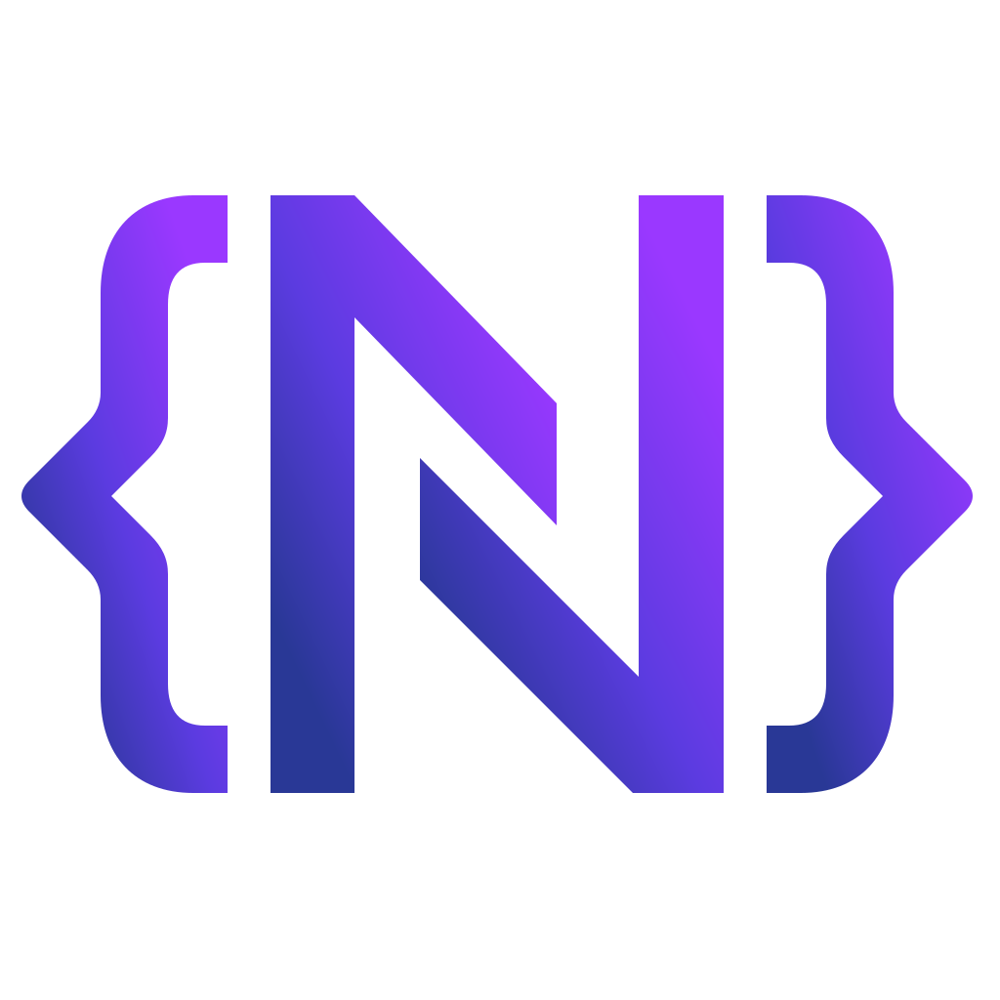

<p align="center">
  
</p>

<h1 align="center">Ndigo</h1>

<p align="center">
  <strong>One TypeScript framework. Both sides of the wire.</strong>
</p>

<p align="center">
  <a href="https://ndigo.dev">Website</a> ·
  <a href="https://github.com/ndigo/ndigo">Framework</a> ·
  <a href="https://github.com/ndigo/ndigo/tree/main/docs">Documentation</a>
</p>

## What is Ndigo?

Ndigo gives TypeScript applications the structure of a server framework and the reach of the web. One context, one dispatcher, and one view model are shared by browser and Node, so server-rendered islands, micro frontends, SPAs, and APIs run on the same primitives.

It is a set of composable packages, not a fixed stack: start with the core, then adopt routing, views, HTTP, persistence, auth, and telemetry only when an application needs them.

## One set of primitives

- **Application context** — typed dependency injection and configuration, identical in the browser and on the server.
- **Dispatcher** — routing, parameter binding, and request semantics shared across platforms.
- **View model** — server-rendered islands, Web Components, and content negotiation behind one abstraction.
- **Standard web platform** — ESM, `fetch`, Web Components, and native Node HTTP; no proprietary runtime.

## Repositories

| Repository                                            | Description                                                                   |
| :---------------------------------------------------- | :---------------------------------------------------------------------------- |
| [**ndigo**](https://github.com/ndigo/ndigo)           | The framework: packages, demo applications, guides, and architecture decisions |
| [**ndigo-site**](https://github.com/ndigo/ndigo-site) | The [ndigo.dev](https://ndigo.dev) website                                    |

## Getting started

Ndigo is under active development and its packages are not yet published to npm. Build the framework from source:

```bash
git clone https://github.com/ndigo/ndigo.git
cd ndigo
pnpm install
pnpm build
pnpm test
```

The [demo ladder](https://github.com/ndigo/ndigo/tree/main/apps) walks from a minimal SPA and a minimal Node server up to RealWorld front ends and APIs, server-rendered islands, and a full design system.

**Requirements:** Node.js ≥ 24 and pnpm ≥ 12.

## Contributing

Ndigo is pre-1.0: APIs may change between releases, and feedback is most valuable while the design is still fluid. Read [CONTRIBUTING.md](https://github.com/ndigo/ndigo/blob/main/CONTRIBUTING.md) before opening an issue or pull request.

## License

ISC — see [LICENSE](https://github.com/ndigo/ndigo/blob/main/LICENSE).
